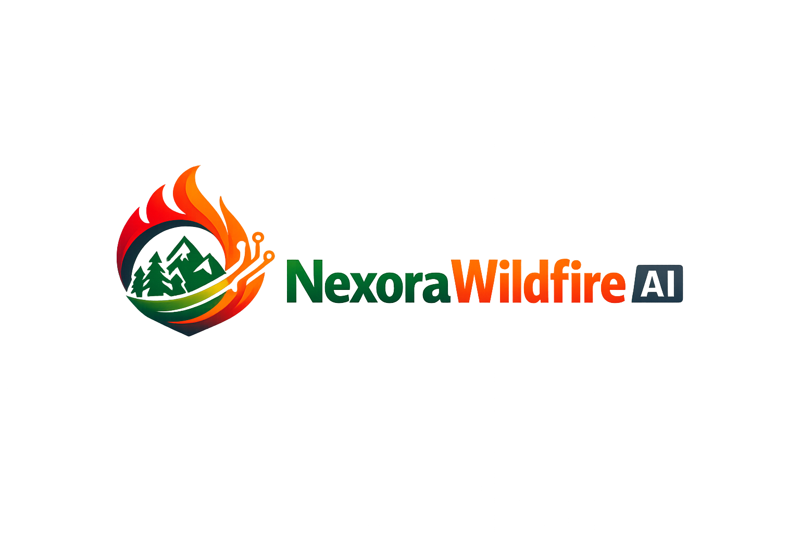
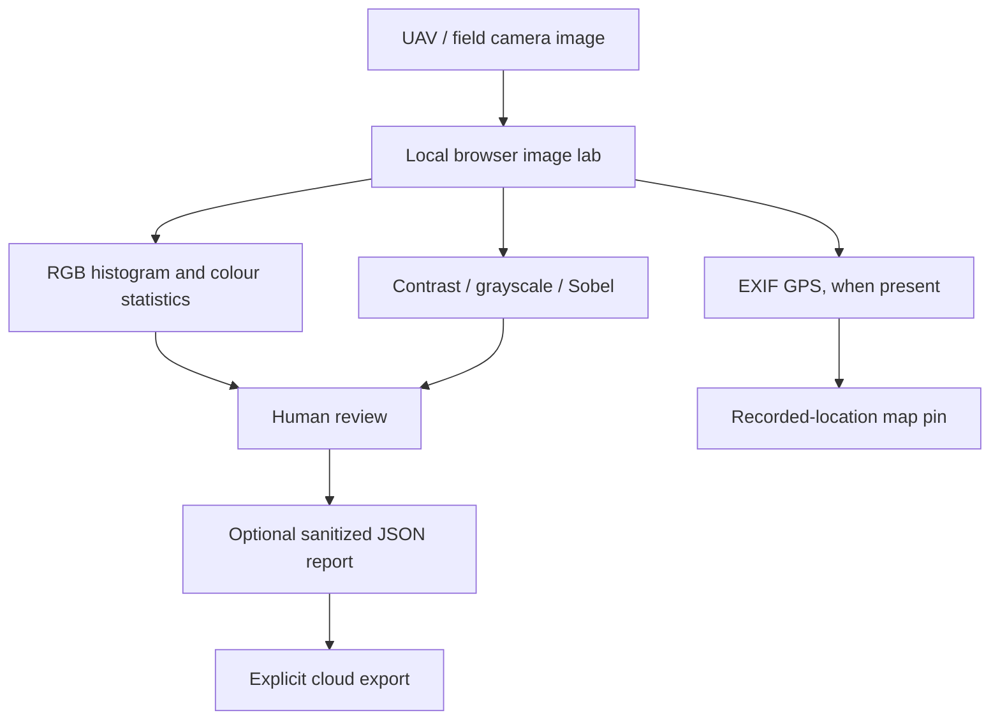

# NexoraWildfire AI

**Environmental intelligence for forests, farms, and the people who care for them.**

NexoraWildfire AI is an independent environmental decision-support project by Nexora. It brings available weather, satellite-discovery, wildfire-awareness, agriculture, soil-and-water, beekeeping, pollen, and ecosystem observations into a map-first workspace. The first pilot area is Thrace (Trakya), Türkiye.

## From field image to reviewable evidence

The first pilot area is Thrace, Türkiye. The goal is to make observations easier to inspect—even when connectivity is intermittent—without pretending that a heuristic is a validated detector.

**Research status:** RGB statistics and Sobel filters are local image-analysis tools, not a trained fire/smoke detector. EXIF coordinates show the photo's recorded location, not where a fire started. Source images remain in the browser lab; the optional [Google Cloud report-export demo](docs/CLOUD_INTEGRATION_DEMO.md) only uploads a sanitized JSON report after an explicit manual confirmation.

For a presentation-ready narrative, model/licensing gates, offline limitations, and a responsible drone/tower-camera roadmap, see the [Competition & Research Brief](docs/COMPETITION_PITCH.md).

## Vision

A world where environmental evidence is easier to access and understand, so communities and producers can make better-informed decisions about forests, farms, water, and ecosystems.

## Mission

Build a practical, transparent, and accessible environmental workspace that:
- connects relevant observations and clearly identifies their source, timestamp, coverage, and limitations;
- helps farmers, beekeepers, local communities, and environmental teams explore the conditions affecting their areas;
- distinguishes measured observations, rule-based indicators, research models, and unavailable data instead of presenting them as equivalent;
- improves through field feedback, reproducible tests, and responsible use of technology.

The project is inspired by Mustafa Kemal Atatürk's emphasis on science, production, and public benefit. This is a project-level inspiration statement; NexoraWildfire AI is not a government service and is not affiliated with a government agency.

## Explore the product

- **Nexora Insight AI**: bilingual, explainable regional analysis workspace that scans the existing environmental API and reports source coverage and missing inputs. See [engine architecture and limits](docs/NEXORA_INSIGHT_ENGINE.md).
- **Interactive map** with available geographic layers and saved areas.
- **Field workspace** for farms, apiaries, forests, and other user-selected areas.
- **Weather and environmental indicators** when supported data providers are reachable.
- **Satellite-scene discovery** intended to support vegetation and land-observation workflows.
- **Responsive, installable web app** with an offline-first shell and local saved-area experience.
- **Experimental image-analysis page:** [UAV / image lab](pages/uav-demo.html).
- **Competition presentation and research story:** [Competition & Research Brief](docs/COMPETITION_PITCH.md).
- **Optional privacy-aware cloud export demo:** [Google Cloud report export](docs/CLOUD_INTEGRATION_DEMO.md). Fire/smoke inference is intentionally disabled after removing the AGPL-licensed runtime and checkpoint. It will only be re-enabled after selecting a license-compatible model and validating it with labelled regional data.
- **Experimental weather-risk index:** [methodology and limitations](docs/NEXORA_RISK_INDEX.md). The current index is rule-based and has not been calibrated or validated for operational fire prediction.
- **Turkish and English interface**; the initial language follows the browser locale (Turkish for Turkish locales, English otherwise).

## AI-assisted engineering

Modern AI coding agents and LLM tools support implementation, code explanation, debugging, documentation, and test design. Product direction, architecture, review, and responsibility remain human-led. AI-generated code is not treated as proof of correctness: changes require review and reproducible tests. See [AI-assisted development disclosure](AI_ASSISTED_DEVELOPMENT.md).

## Current scope and evidence

The first practical focus is Thrace, Türkiye. Global coordinates and reusable geographic inputs do not prove that every provider, model, or workflow has been validated worldwide.

The app may display provider observations, rule-based indicators, satellite discovery results, and machine-learning research outputs. These are different forms of evidence. The research model trained on a small historical Algerian dataset is **not validated for Türkiye** and must not be represented as an operational wildfire forecast. NexoraWildfire AI is experimental decision support, not an official warning service. In an emergency, follow the relevant authorities.

Provider access and production behavior must be verified independently; code for an integration is not proof that its live connection is working. Missing credentials, provider errors, and zero observations must not be presented as zero risk. The YOLO page draws boxes only from API responses. A working API response demonstrates integration, not detection accuracy; a synthetic blank-frame check is not positive fire/smoke validation.

## Pricing and sustainability

The project is currently in a pilot and verification stage. **Payments and automatic paid-plan upgrades are not enabled.** Proposed plans and usage limits are planning values, not an offer to purchase. Prices will be decided only after measuring hosting, database, worker/compute, and external-provider costs; testing failure and retry behavior; and defining security, privacy, support, and subscription operations. Any commercial launch will be planned with appropriate family/guardian support.

See [SaaS limits and pricing plan](docs/SAAS_LIMITS_AND_PRICING.md) for the cost-measurement and launch checklist.

## Technology

- Front end: HTML, CSS, JavaScript, Leaflet, and Progressive Web App features.
- Optional backend: FastAPI.
- Cloud features: Supabase where configured.
- External integrations: Open-Meteo, Copernicus/Sentinel-2 discovery, and NASA FIRMS where credentials, access, and endpoints are configured.

## Try it and contribute

- **Live app:** https://nexora88.github.io/nova-forest-ai/
- **Source code:** https://github.com/Nexora88/nova-forest-ai
- **Bug reports and product suggestions:** https://github.com/Nexora88/nova-forest-ai/issues
- **Türkçe README:** [README.tr.md](README.tr.md)
- **Contributing:** [.github/CONTRIBUTING.md](.github/CONTRIBUTING.md)
- **Global architecture notes:** [docs/GLOBAL_SCALABILITY.md](docs/GLOBAL_SCALABILITY.md)
- **AI-assisted development disclosure:** [AI_ASSISTED_DEVELOPMENT.md](AI_ASSISTED_DEVELOPMENT.md)
- **Nexora Risk Index methodology:** [docs/NEXORA_RISK_INDEX.md](docs/NEXORA_RISK_INDEX.md)
- **Scientific status and validation plan:** [docs/SCIENTIFIC_STATUS.md](docs/SCIENTIFIC_STATUS.md)
- **Third-party licenses and notices:** [THIRD_PARTY_NOTICES.md](THIRD_PARTY_NOTICES.md)
- **Research model card:** [English](docs/ML_MODEL_CARD.md) · [Türkçe](docs/ML_MODEL_CARD.tr.md)

The repository `LICENSE` covers Nexora-authored code only. Third-party model weights, datasets, map tiles, libraries, and provider data retain their own terms; see [Third-party notices](THIRD_PARTY_NOTICES.md). The MIT license does not relicense those materials. Licensing and deployment suitability for the AGPL-3.0 YOLO/Ultralytics stack must be reviewed before redistribution.

The priority is a dependable core product: clear map layers, understandable indicators, reliable saved areas, transparent data status, accessible mobile use, and feedback from real users. New features should solve a real user problem rather than add complexity for its own sake.

---

**Independent project by Ahmet Eymen Bakraç · Nexora · 2026**

## Gerçek YOLOv8 çıkarımı

İHA / Yapay Zekâ sayfası ve model servisinin kurulumu, model kaynağı/lisansı, API sözleşmesi ve doğrulama sınırları için [YOLO çıkarım rehberini](docs/YOLO_INFERENCE.md) inceleyin. Çalışan çıkarım için `backend/requirements-ml.txt` ile ayrı ML container gerekir; Vercel statik/standart API dağıtımı tek başına PyTorch modelinin çalıştığı anlamına gelmez.

## Scientific status, licensing, and transparency

- [Scientific status and validation plan](docs/SCIENTIFIC_STATUS.md)
- [Third-party licenses and notices](THIRD_PARTY_NOTICES.md)
- [Research model card — English](docs/ML_MODEL_CARD.md) · [Türkçe](docs/ML_MODEL_CARD.tr.md)
- [AI-assisted development disclosure (English + Türkçe)](AI_ASSISTED_DEVELOPMENT.md)

The MIT license applies to Nexora-authored code only; it does not relicense third-party weights, data, map tiles, or dependencies. AI coding assistants are used for technical debugging, code explanation, tests, translation, and documentation—not as the originator of the project concept. See the disclosure for the complete statement.
