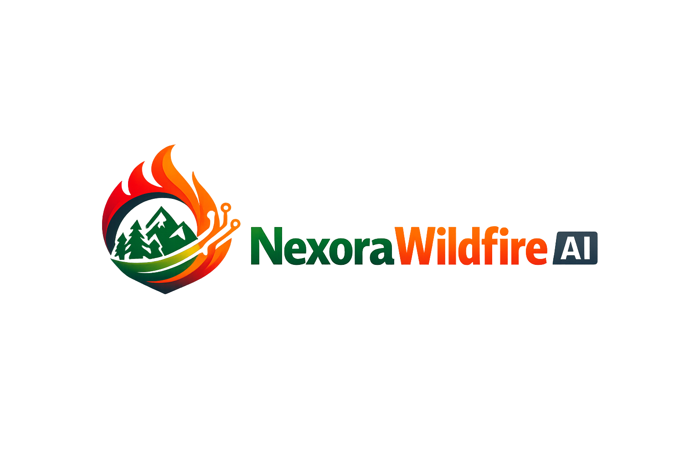
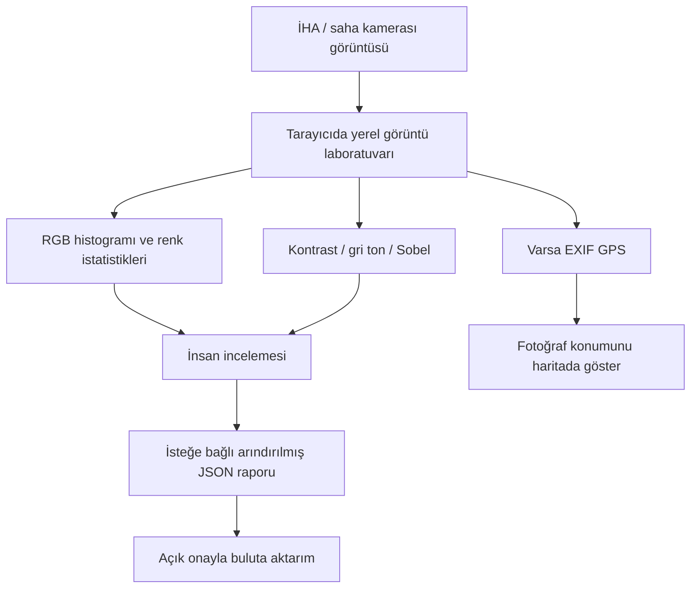

# NexoraWildfire AI

**Ormanlar, tarlalar ve onlara bağlı yaşam için çevresel istihbarat.**

NexoraWildfire AI, Nexora tarafından geliştirilen bağımsız bir çevresel karar destek projesidir. Mevcut hava durumu, uydu sahnesi keşfi, yangın farkındalığı, tarım, toprak ve su, arıcılık, polen ve ekosistem gözlemlerini harita merkezli bir çalışma alanında bir araya getirmeyi amaçlar. İlk pilot bölge **Trakya, Türkiye**'dir.

[English README](README.md) · [AI destekli geliştirme beyanı](AI_ASSISTED_DEVELOPMENT.md) · [Küresel mimari notları](docs/GLOBAL_SCALABILITY.md) · [Katkı rehberi](.github/CONTRIBUTING.md)

## Saha görüntüsünden incelenebilir kanıta

İlk pilot alan Trakya, Türkiye'dir. Amaç, bağlantı zayıfken bile görüntüleri inceleyebilmek; ancak kural tabanlı bir göstergiyi doğrulanmış yangın tespiti gibi sunmamaktır.

**Araştırma durumu:** RGB istatistikleri ve Sobel filtreleri yerel görüntü işleme araçlarıdır; eğitilmiş yangın/duman tespit modeli değildir. EXIF koordinatı, fotoğrafın kaydedilmiş konumunu gösterir; yangının başladığı yeri kanıtlamaz. Kaynak fotoğraf tarayıcı laboratuvarında kalır. İsteğe bağlı [Google Cloud rapor aktarım demosu](docs/CLOUD_INTEGRATION_DEMO.md) yalnızca açık komut satırı onayından sonra arındırılmış JSON raporunu yükler.

Sunum anlatımı, model/lisans koşulları, çevrimdışı kullanım sınırları ve sorumlu İHA/gözetleme kamerası yol haritası için [Yarışma ve Araştırma Dosyası](docs/COMPETITION_PITCH.md) belgesine bakın.

## Vizyon

Çevresel kanıtların daha kolay erişilebilir ve anlaşılır olduğu; toplulukların ve üreticilerin ormanlar, tarlalar, su kaynakları ve ekosistemler hakkında daha bilinçli kararlar verebildiği bir gelecek.

## Misyon

Aşağıdaki hedeflere hizmet eden kullanışlı, şeffaf ve erişilebilir bir çevresel çalışma alanı geliştirmek:
- İlgili gözlemleri bir araya getirmek; kaynaklarını, zaman damgalarını, kapsama alanını ve sınırlamalarını açıkça belirtmek.
- Çiftçilerin, arıcıların, yerel toplulukların ve çevre ekiplerinin kendi alanlarını etkileyen koşulları incelemesine yardımcı olmak.
- Ölçülmüş gözlemleri, kural tabanlı göstergeleri, araştırma modellerini ve erişilemeyen verileri birbirinden ayırmak.
- Saha geri bildirimi, tekrarlanabilir testler ve teknolojinin sorumlu kullanımıyla ürünü geliştirmek.

Proje, Mustafa Kemal Atatürk'ün bilim, üretim ve toplumsal faydaya verdiği önemden ilham alır. Bu, projenin kendi vizyon açıklamasıdır; NexoraWildfire AI resmî bir kamu hizmeti değildir ve herhangi bir devlet kurumuna bağlı değildir.

## Ürünü keşfet

- **Nexora Insight AI:** Mevcut çevresel API verilerini tarayan, kaynak kapsamını ve eksik girdileri gösteren iki dilli, açıklanabilir bölgesel analiz alanı. [Motor mimarisi ve sınırları](docs/NEXORA_INSIGHT_ENGINE.md).\n- **Etkileşimli harita:** Kullanılabilir coğrafi katmanlar ve kaydedilmiş alanlar.
- **Saha çalışma alanı:** Tarla, arılık, orman ve kullanıcının seçtiği diğer alanlar.
- **Hava ve çevre göstergeleri:** Yalnızca ilgili veri sağlayıcılarına erişilebildiğinde.
- **Uydu sahnesi keşfi:** Bitki örtüsü ve arazi gözlemi iş akışlarını desteklemek üzere tasarlanmıştır.
- **Mobil uyumlu, yüklenebilir web uygulaması:** Çevrimdışı öncelikli uygulama kabuğu ve yerel kayıtlı alan deneyimi.
- **Türkçe ve İngilizce arayüz:** İlk dil, tarayıcı diline göre seçilir (Türkçe tarayıcılarda Türkçe, diğerlerinde İngilizce).
- **Yarışma sunumu ve araştırma anlatısı:** [Yarışma ve Araştırma Dosyası](docs/COMPETITION_PITCH.md).
- **İsteğe bağlı, gizlilik odaklı bulut aktarımı:** [Google Cloud rapor aktarım demosu](docs/CLOUD_INTEGRATION_DEMO.md).
- **İHA / görüntü laboratuvarı:** AGPL-3.0 lisanslı algılama çalışma zamanı ve model kaldırıldığı için yangın/duman çıkarımı şimdilik devre dışıdır. Yalnızca MIT lisanslama hedefiyle uyumlu bir model seçilip etiketli bölgesel verilerle bağımsız doğrulama yapıldıktan sonra yeniden etkinleştirilebilir.

## Mevcut kapsam ve kanıt

İlk pratik odak Trakya, Türkiye'dir. Küresel koordinatları desteklemek, her veri sağlayıcısının, modelin veya iş akışının dünyanın her yerinde doğrulandığı anlamına gelmez.

Uygulama; sağlayıcı gözlemleri, kural tabanlı göstergeler, uydu sahnesi keşif sonuçları ve makine öğrenmesi araştırma çıktılarını gösterebilir. Bunlar birbirinden farklı kanıt türleridir. Küçük ve geçmişe ait bir Cezayir veri kümesiyle eğitilmiş araştırma modeli **Türkiye için doğrulanmamıştır** ve operasyonel yangın tahmini gibi sunulmamalıdır. NexoraWildfire AI deneysel bir karar destek projesidir, resmî uyarı sistemi değildir. Acil durumlarda yetkili kurumların yönlendirmelerine uyun.

Bir entegrasyonun kodda bulunması, canlı bağlantısının çalıştığını kanıtlamaz; sağlayıcı erişimi ve üretim davranışı ayrıca doğrulanmalıdır. Eksik kimlik bilgileri, sağlayıcı hataları ve sıfır gözlem, sıfır risk olarak gösterilmemelidir. Gerçek YOLO arayüzü kutuları yalnızca API yanıtından çizer; entegrasyonun çalışması algılama doğruluğunu kanıtlamaz. Sentetik boş kare testi yangın/duman doğrulaması değildir.

## Fiyatlandırma ve sürdürülebilirlik

Proje şu anda pilot ve doğrulama aşamasındadır. **Ödeme alma ve ücretli plana otomatik geçiş etkin değildir.** Önerilen planlar ve kullanım limitleri satın alma teklifi değil, planlama değerleridir. Fiyatlar ancak barındırma, veritabanı, işçi/hesaplama ve haricî sağlayıcı maliyetleri ölçüldükten; hata ve yeniden deneme senaryoları test edildikten; güvenlik, gizlilik, destek ve abonelik süreçleri tanımlandıktan sonra belirlenecektir. Ticari lansman, uygun aile/veli desteğiyle planlanacaktır.

Maliyet ölçümü ve lansman kontrol listesi için [SaaS limitleri ve fiyatlandırma planı](docs/SAAS_LIMITS_AND_PRICING.md) belgesine bakın.

## Yapay zekâ destekli mühendislik

Projenin ana fikri, çevresel karar desteği amacı, ürün yönü ve kapsam tercihleri proje geliştiricisine aittir. Yapay zekâ kodlama asistanları teknik hataları incelemek, olası düzeltmeleri değerlendirmek, kodu açıklamak, test senaryoları ve belgeler hazırlamak için yardımcı araçlar olarak kullanılır; projenin sahibi veya fikrin kaynağı olarak gösterilmez. Ayrıntılar için [iki dilli geliştirme beyanını](AI_ASSISTED_DEVELOPMENT.md) okuyun.

## İHA / gerçek YOLOv8 arayüzü

[İHA / Yapay Zekâ laboratuvarı](pages/uav-demo.html), seçilen videodan belirli kareleri yapılandırılmış API servisine gönderir ve yalnızca modelin döndürdüğü algılama kutularını gösterir. Servis adresi ve çalışma durumu doğrulanmadan canlı algılama varmış gibi kabul edilmemelidir. Model Türkiye/Trakya koşullarında bağımsız olarak doğrulanmış değildir; resmî yangın alarmı değildir. Kurulum, lisans ve API ayrıntıları için [YOLO rehberi](docs/YOLO_INFERENCE.md) ve [bilimsel durum belgesi](docs/SCIENTIFIC_STATUS.md) incelenmelidir.

## Teknoloji

- Ön yüz: HTML, CSS, JavaScript, Leaflet ve Progressive Web App özellikleri.
- İsteğe bağlı backend: FastAPI.
- Bulut özellikleri: Yapılandırıldığı yerlerde Supabase.
- Haricî entegrasyonlar: Kimlik bilgileri, erişim izinleri ve uç noktalar yapılandırıldığı yerlerde Open-Meteo, Copernicus/Sentinel-2 keşfi ve NASA FIRMS.

Depodaki `LICENSE`, yalnızca Nexora tarafından yazılan kodu kapsar. Üçüncü taraf model ağırlıkları, veri kümeleri, harita döşemeleri, kütüphaneler ve sağlayıcı verileri kendi koşullarına tabidir. MIT lisansı bunları yeniden lisanslamaz. AGPL-3.0 YOLO/Ultralytics bileşenlerinin dağıtım ve servis koşulları ayrıca incelenmelidir. Ayrıntılar: [Üçüncü taraf lisans bildirimleri](THIRD_PARTY_NOTICES.md).

## Uygulamayı deneyin ve katkı sağlayın

- **Canlı uygulama:** https://nexora88.github.io/nova-forest-ai/
- **Kaynak kod:** https://github.com/Nexora88/nova-forest-ai
- **Hata ve ürün önerileri:** https://github.com/Nexora88/nova-forest-ai/issues
- **English README:** [README.md](README.md)
- **Katkı rehberi:** [.github/CONTRIBUTING.md](.github/CONTRIBUTING.md)
- **Küresel mimari notları:** [docs/GLOBAL_SCALABILITY.md](docs/GLOBAL_SCALABILITY.md)
- **Bilimsel durum ve doğrulama planı:** [docs/SCIENTIFIC_STATUS.md](docs/SCIENTIFIC_STATUS.md)
- **Üçüncü taraf lisans ve bildirimleri:** [THIRD_PARTY_NOTICES.md](THIRD_PARTY_NOTICES.md)
- **Araştırma model kartı:** [Türkçe](docs/ML_MODEL_CARD.tr.md) · [English](docs/ML_MODEL_CARD.md)
- **AI destekli geliştirme beyanı:** [AI_ASSISTED_DEVELOPMENT.md](AI_ASSISTED_DEVELOPMENT.md)

Öncelik; anlaşılır harita katmanları, yorumlanabilir göstergeler, güvenilir kayıtlı alanlar, şeffaf veri durumu, erişilebilir mobil kullanım ve gerçek kullanıcı geri bildirimidir. Yeni özellikler sırf karmaşıklık katmak için değil, gerçek bir ihtiyacı çözmek için eklenmelidir.

---

**Ahmet Eymen Bakraç · Nexora · Bağımsız proje · 2026**

## Önemli sınırlama

NexoraWildfire AI geliştirilmekte olan bir araştırma ve karar destek projesidir. Resmî uyarı sistemi değildir; yangını kesin tahmin etmeyi garanti etmez ve yerel kurumların, uzman değerlendirmesinin veya acil durum prosedürlerinin yerini almamalıdır.

## Bilimsel durum, lisans ve şeffaflık

- [Bilimsel durum ve doğrulama planı](docs/SCIENTIFIC_STATUS.md)
- [Üçüncü taraf lisans ve bildirimleri](THIRD_PARTY_NOTICES.md)
- [Araştırma model kartı — Türkçe](docs/ML_MODEL_CARD.tr.md) · [English](docs/ML_MODEL_CARD.md)
- [Yapay zekâ destekli geliştirme beyanı (Türkçe + English)](AI_ASSISTED_DEVELOPMENT.md)

MIT lisansı yalnızca Nexora tarafından yazılan kod için geçerlidir; üçüncü taraf model ağırlıklarını, verileri, harita döşemelerini veya bağımlılıkları yeniden lisanslamaz. Yapay zekâ kodlama asistanları teknik hata ayıklama, kod açıklama, test, çeviri ve belge hazırlama için kullanılır; proje fikrinin kaynağı olarak gösterilmez. Ayrıntı için geliştirme beyanını okuyun.
