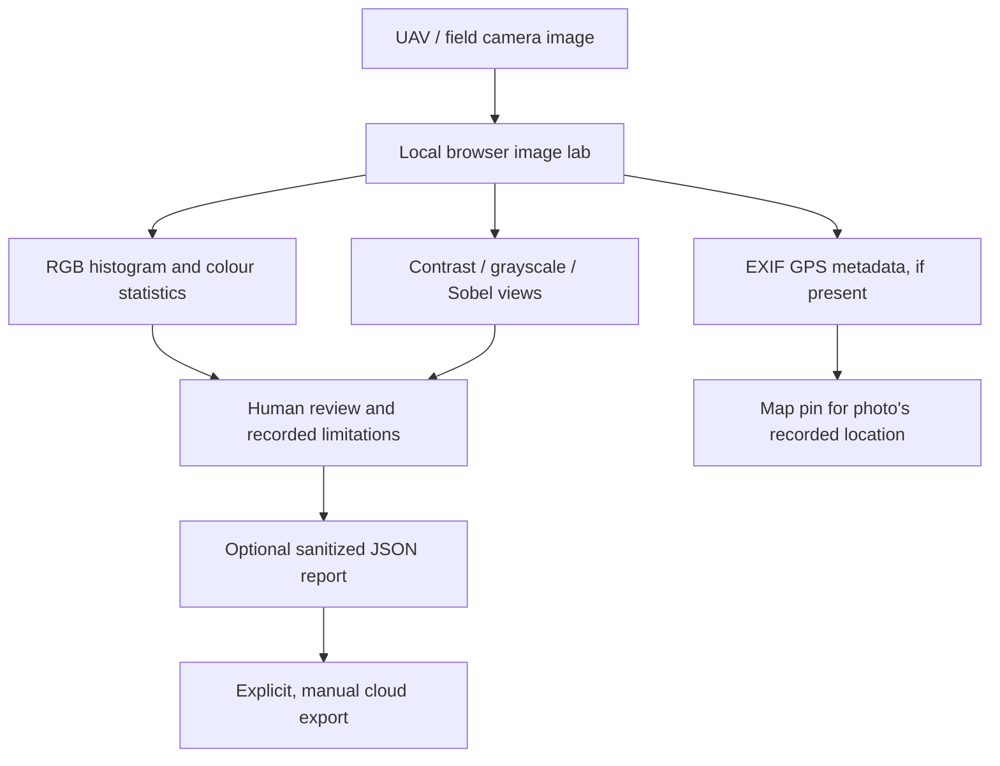

# NexoraWildfire AI — Competition & Research Brief

## The problem

Wildfire response and rural environmental work depend on observations gathered from different places: weather services, satellite products, field teams, cameras, and—where available—UAV imagery. In a field situation, connectivity can be unreliable and raw data may contain sensitive location metadata. A responsible tool should keep useful local tools available, identify the source of each observation, and state what it cannot conclude.

## What this project demonstrates today

- A map-first environmental workspace with Turkish/English UI and an installable web-app shell.
- Local browser image processing: RGB channel histograms, transparent rule-based color statistics, contrast adjustment, grayscale, and Sobel edge visualization.
- JPEG EXIF GPS extraction when the source image actually contains those fields, with a link to show the recorded coordinates on the map.
- A connectivity indicator that reports the browser's online/offline signal, not the health of every data source.
- An optional, manual Google Cloud Storage JSON-report export demo. It is not automatically connected to the website, uploads no image bytes, and strips location data by default.
- Documentation and test gates that separate live observations, heuristic indicators, research models, and unavailable data.

## Research pipeline

This is an image-analysis and evidence-review pipeline. The RGB heuristics and edge filters are **not** a trained fire/smoke classifier. A GPS tag indicates where the photo was recorded, not where a fire started. The map basemap may still need cached tiles or internet.

## Model and licensing transparency

Fire/smoke model inference is intentionally disabled until the exact model code and weights have a compatible license and are validated on appropriately labelled regional data. The historical Algerian research model is not validated for Türkiye or Thrace. Do not show fake bounding boxes, describe color thresholds as AI, or use a blank-frame test as evidence of detection accuracy.

Before enabling an inference model, record:
1. Exact repository/model and immutable version.
2. Code and weight licenses separately.
3. Training dataset source, license, geography, dates, class definitions, and known biases.
4. A region-specific, held-out evaluation set and independent review.
5. Precision/recall and false-positive/false-negative analysis by lighting, smoke density, terrain, season, and camera type.
6. A model card, reproducible evaluation command, safety limitations, and rollback plan.

## Offline behavior: honest scope

After the app shell has been loaded and cached while online, the static UI and the browser's local image tools can remain available offline. Browser storage is device/browser-specific and may be cleared by the user or operating system. Live weather, live satellite discovery, remote API inference, and uncached basemap tiles require a network connection. Offline mode must not invent live data or silently turn missing data into zero risk.

## Cloud integration demo

See [Optional Google Cloud report export](CLOUD_INTEGRATION_DEMO.md). The demo uploads a sanitized JSON report only after an explicit command-line confirmation. It does not upload source images or prove that a cloud model is deployed. Real cloud inference would require a separately secured and cost-controlled service, a compatible model license, regional validation, privacy/retention rules, and monitoring.

## Drone / tower-camera applicability

The architecture could later accept authorized still images from a drone or fixed camera through an approved workflow. A production integration would additionally need device/operator authorization, safe flight and data procedures, timestamp/coordinate provenance, resilient communications, secure storage, incident audit logs, and human confirmation before operational use. This repository does not claim a certified drone integration or official emergency-warning capability.

## Suggested short jury explanation

> “NexoraWildfire AI is an independent environmental decision-support prototype focused first on Thrace. If connectivity is lost, its cached app shell and local browser tools can still inspect a field image: the RGB histogram quantifies colour-channel distribution, Sobel makes edges easier to inspect, and EXIF parsing can recover a camera-recorded GPS point when metadata exists. These are explainable image-analysis tools—not a claim that colour alone detects fire. We separate observations, heuristics, and AI models, and only enable fire/smoke inference after license review and region-specific validation. An optional, explicit cloud-export demo shows how a sanitized report could be stored without automatically uploading the original image.”

## References and further reading

- [Scientific status and validation plan](SCIENTIFIC_STATUS.md)
- [Research model card — English](ML_MODEL_CARD.md) · [Türkçe](ML_MODEL_CARD.tr.md)
- [Third-party license notices](../THIRD_PARTY_NOTICES.md)
- [YOLO inference setup](YOLO_INFERENCE.md)
- [Thrace dataset protocol](THRACE_DATASET_PROTOCOL.md)
- [Cloud export demo](CLOUD_INTEGRATION_DEMO.md)
